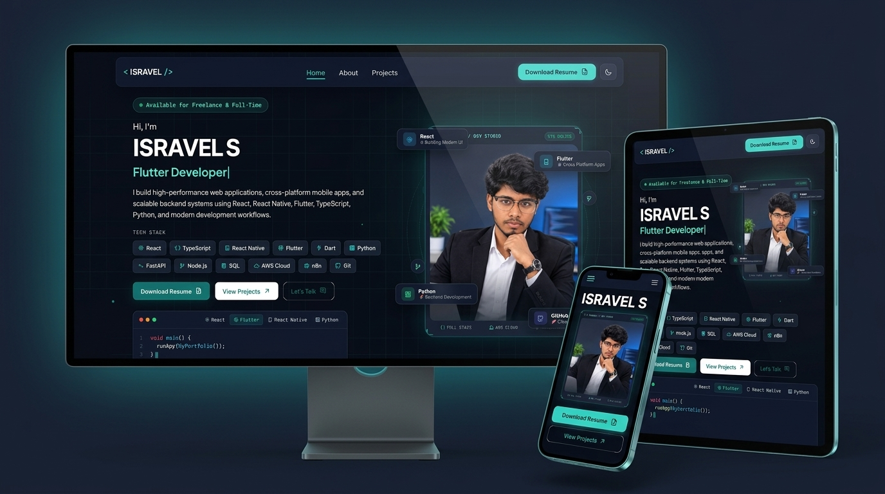

<div align="center">

# 🌐 ISRAVEL S — Modern Tech Developer Portfolio

[](https://israveltech.github.io/My-Portfolio/)
[](https://github.com/IsravelTECH)
[](LICENSE)
[](https://israveltech.github.io/My-Portfolio/)

<br />

<!-- Multi-Device Showcase Banner -->


<br />

<p align="center">
  <strong>A high-performance, responsive developer portfolio engineered with Vanilla HTML5, modern CSS3 architecture, 3D WebGL / Three.js project showcases, dynamic Day/Night theme engine, interactive slide-out project inspector, and EmailJS enquiry automation.</strong>
</p>

<p align="center">
  <a href="#-key-features">Key Features</a> •
  <a href="#-tech-stack">Tech Stack</a> •
  <a href="#-featured-projects">Featured Projects</a> •
  <a href="#-project-structure">Project Structure</a> •
  <a href="#-quick-start">Quick Start</a> •
  <a href="#-connect-with-me">Connect</a>
</p>

</div>

---

## 🚀 Key Features

- **📱 Fully Responsive Multi-Device UI/UX**:
  - Pixel-perfect layout across Ultra-Wide screens, Desktops, Tablets, and Mobile phones ($320\text{px} - 1920\text{px}+$).
  - Zero horizontal overflow and optimized typography scaling.

- **🎨 Cyber Tech HUD Hero Panel**:
  - Custom developer portrait with holographic scanner line animation, system online status indicator, and interactive 3D tilt effects (`vanilla-tilt`).
  - Sleek $2 \times 2$ floating credential badges (`React`, `Flutter`, `Python`, `GitHub`) with responsive positioning.

- **🌓 Dynamic Day / Night Theme Engine**:
  - Smooth theme transitions with local storage persistence.
  - Custom color tokens for dark cyber-teal and clean minimal light modes.

- **🔍 Interactive Project Inspector Drawer**:
  - Slide-out architectural inspector drawer providing deep-dive overviews, technology stacks, live deployments, and repository links without page reloads.

- **🕶️ 3D Interactive Project Showcases**:
  - Dedicated support and categorization for 3D Web applications built with **Three.js** and **WebGL** (e.g., *ShoeHaven 3D* & *Buy & Sell 3D*).

- **📜 Certificate Lightbox Gallery**:
  - Interactive full-screen credential viewer with keyboard navigation (`Esc`, `←`, `→`).

- **⚡ Fast, Lightweight & Dependency-Free**:
  - Built with pure vanilla technologies for instant load speeds, optimal Core Web Vitals, and zero bundle overhead.

---

## 🛠️ Tech Stack

### Core Technologies


### Frameworks & Libraries


### Cloud, Automation & Tools


---

## 💻 Featured Projects

| Project | Platform / Type | Tech Stack | Live | Source Code |
| :--- | :--- | :--- | :---: | :---: |
| **ParkMe** | Smart Parking System (Web, Mobile & Desktop) | React, Leaflet, Node.js, Express, MongoDB | [Live](https://parkme-six.vercel.app/) | [GitHub](https://github.com/IsravelTECH/parkme-frontend) |
| **BuyBuddy** | Full-Stack Multi-Vendor E-Commerce Suite (Web & Mobile) | React.js, React Native, Node.js, MongoDB, Stripe | [Live](https://e-commerce-store-anqa.onrender.com/) | [GitHub](https://github.com/IsravelTECH/BuyBuddy) |
| **Foodie Express** | On-Demand Food Delivery Platform | React, Vite, Node.js, Express, MongoDB, Stripe | [Live](https://foodie-express-delivery-seven.vercel.app/) | [GitHub](https://github.com/IsravelTECH/Foodie-Express-Frontend) |
| **ShoeHaven 3D** | 3D Interactive Footwear & E-Commerce Website | Three.js / 3D, WebGL, React.js, JavaScript, Vercel | [Live](https://shoe-haven-delta.vercel.app/) | [GitHub](https://github.com/IsravelTECH/Shoe-Haven) |
| **Buy & Sell** | 3D Interactive Marketplace & Trading Platform | Three.js, WebGL, JavaScript, Node.js, Render | [Live](https://buysellunplugged.onrender.com/) | [GitHub](https://github.com/IsravelTECH/Buy-Sell) |
| **Professional Portfolio** | High-Performance Responsive Multi-Device Portfolio | HTML5, CSS3 Architecture, Vanilla JS, EmailJS | [Live](https://israveltech.github.io/My-Portfolio/) | [GitHub](https://github.com/IsravelTECH/My-Portfolio) |

---

## 📁 Project Structure

```bash
My-Portfolio/
├── index.html                 # Main single-page application structure
├── css/
│   └── style.css              # Modular CSS design system & media queries
├── js/
│   └── main.js                # Core UI interactions, theme engine & drawer
├── images/
│   ├── Certificates/          # Verified course & achievement credentials
│   ├── My Image/              # Profile portraits, avatars & banner panels
│   └── My-Projects/           # High-resolution responsive project showcases
│       ├── isravel_responsive_devices_showcase.jpg
│       ├── parkme_responsive_showcase.jpg
│       ├── buybuddy_responsive_showcase.jpg
│       ├── foodieexpress_responsive_showcase.jpg
│       ├── shoe_haven_responsive_3D.jpg
│       └── Buy&Sell_commerce_responsive_3D.jpg
└── .gitignore                 # Ignored dependencies & system files
```

---

## ⚡ Quick Start

To preview or run this portfolio locally:

1. **Clone the repository**:
   ```bash
   git clone https://github.com/IsravelTECH/My-Portfolio.git
   cd My-Portfolio
   ```

2. **Launch a local server**:
   You can open `index.html` directly in your browser or serve it using any local static file server:

   ```bash
   # Using Python 3
   python -m http.server 3000

   # Or using Node.js npx serve
   npx serve .
   ```

3. **Visit**: Open [http://localhost:3000](http://localhost:3000) in your web browser.

---

## 📬 Connect With Me

- **Portfolio**: [israveltech.github.io/My-Portfolio](https://israveltech.github.io/My-Portfolio/)
- **GitHub**: [@IsravelTECH](https://github.com/IsravelTECH)
- **Email**: [isravel2004@gmail.com](mailto:isravel2004@gmail.com)
- **Location**: Chennai, Tamil Nadu, India

---

<div align="center">
  <sub>Designed & Developed with ❤️ by <strong>ISRAVEL S</strong>. All rights reserved.</sub>
</div>
